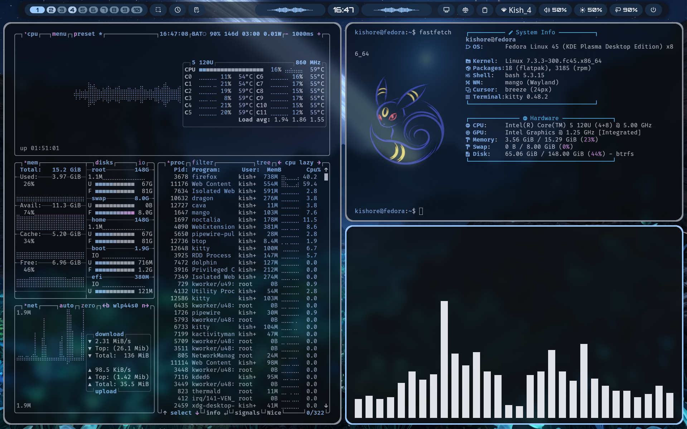

### Configs
This repo contains config files to recreate my desktop setup.
You need the following packages to run it:
* MangoWM
* Noctalia
* sddm (optional, but nice to have if you want to login via GUI)
* zed
* cava
* nvim
* fastfetch
* btop

Note : These are just my configs suited to my requirements. The keybinds are similar to that of swaywm.
The current setup runs on 1.5 GiB RAM on idle because of uncountable number of KDE plasma daemons running in the background. I might add a minimal install script in future.

   

